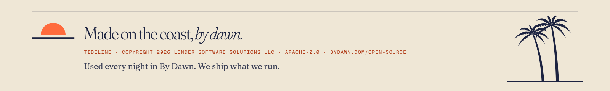

<p align="center">
  <a href="https://bydawn.com/open-source"></a>
</p>

<p align="center">
  <a href="#install">Install</a> ·
  <a href="#there-and-back">There and back</a> ·
  <a href="#the-format">The format</a> ·
  <a href="#3-way-merge">3-way merge</a> ·
  <a href="#plugins">Plugins</a> ·
  <a href="#tiptap-version-policy">Tiptap version policy</a> ·
  <a href="#used-in-by-dawn">Used in By Dawn</a> ·
  <a href="CONTRIBUTING.md">Contributing</a>
</p>

**tideline** converts Markdown to a Tiptap 3 document and back without losing anything. Canonical markdown comes back byte for byte, and everything else is normalised once and then holds. It also merges two edits of a page, line by line, against what they both started from.

It's an ES module, headless, and runs anywhere Node 20 or later does: in a browser editor, and on a server that saves co-edited Yjs documents. It's written for Tiptap 3 and ProseMirror, and its only dependencies are the Tiptap packages you already have.

## Install

```sh
npm install @bydawn/tideline@0.1.1 \
  @tiptap/core@3.31.4 @tiptap/extension-code@3.31.4 @tiptap/extension-code-block@3.31.4 @tiptap/extension-image@3.31.4 @tiptap/extension-list@3.31.4 @tiptap/extension-table@3.31.4 @tiptap/pm@3.31.4 @tiptap/starter-kit@3.31.4
```

## There and back

```ts
import { getSchema } from '@tiptap/core';
import { docSchemaExtensions, docToMarkdown, markdownToDoc, mergeMarkdown } from '@bydawn/tideline';

const body = '# Tide table\n\nHigh water at **05:12**.\n\n- [x] Check the moorings';

// There: the markdown opens as a Tiptap document.
const schema = getSchema(docSchemaExtensions());
const doc = schema.nodeFromJSON(markdownToDoc(body));

// And back: the same bytes.
docToMarkdown(doc.toJSON()) === body; // true

// Two people edited the same page: merge their markdown against what they both started from.
const base = 'Low water at 11:30.\n\nBring rope.';
const mine = 'Low water at 11:45.\n\nBring rope.';
const theirs = 'Low water at 11:30.\n\nBring rope and a lamp.';
mergeMarkdown(base, mine, theirs);
// { clean: true, body: 'Low water at 11:45.\n\nBring rope and a lamp.' }
```

## The format

tideline reads and writes one markdown dialect, and it comes with an editor schema that holds exactly that dialect and nothing else. The promise has two parts:

1. **Canonical markdown round-trips byte for byte.** `docToMarkdown(markdownToDoc(body)) === body`.
2. **Anything else is normalised once, then holds.** The second pass changes nothing, and a reader sees the same page before and after.

### What round-trips byte for byte

| Construct | Canonical form |
|---|---|
| Paragraphs and hard breaks | Lines of text; one newline is a hard break |
| Bold, italic, both | `**bold**`, `_italic_`, `**_both_**`, and `un*believ*able` or `x***both***y` where `_` can't work |
| Code | `` `code` ``, ``` ``a ` tick`` ```, and a span that runs across a line |
| Links | `[text](https://…)`, a bare `https://…`, `[text](#anchor)`, `[file](attachment:id)` |
| Page links | `[[target]]`, `[[target\|label]]`. Your application resolves the target |
| Images | ``, `` |
| Headings | `#` to `######`, with an optional pinned `{#anchor}` |
| Lists | `- item`, `3. item` (the start number is kept), `- [ ] task`, `- [x] done`, nested |
| Quotes | `> text`, holding any blocks |
| Callouts | `:::note Title` … `:::`. Kinds: `note`, `tip`, `warning`, `danger` |
| Code blocks | ` ```lang ` fences. A `mermaid` fence opens as its own node |
| Tables | GFM pipes, with `:---`, `---:` and `:---:` alignment |
| Divider | `---` |
| Front matter | `---` lines around a block at the very start of a body, whose first line is `key:`. It opens as a code block with the language `front-matter`, verbatim |
| Literal markers, which CommonMark's flanking rules read as text | `a * b * c`, `*.ts and *.md`, `snake_case_name`, `2*(3+4)*5` |
| Escapes, where text would otherwise read as markup | `\*not emphasis\*`, `https\://not.a.link` |

### What is normalised

| You write | It becomes | Why |
|---|---|---|
| `* a`, `+ a` | `- a` | One bullet spelling |
| `1) a` | `1. a` | One ordered-list spelling |
| `__a__`, `*a*` | `**a**`, `_a_` | One spelling per mark |
| `:::info`, `:::success`, `:::caution`, `:::error` | `:::note`, `:::tip`, `:::warning`, `:::danger` | Aliases of the four kinds |
| `## Title ##` | `## Title` | The closing hashes are decoration |
| An unterminated code fence | A closed one | It runs to the end of the page |
| An indented code block | A fence | One code spelling |
| Emphasis nested more than 32 deep | The markers past that depth, as literal characters | Whatever walks the tree stays within its stack |
| Two adjacent lists of one kind | One list | Markdown cannot write them apart |
| An escape nothing needs, such as `C:\\Users` or a lone `\*` | `C:\Users`, `*` | The writer escapes only what would read as markup |

### What an editor can hold that the format can't

The schema doesn't offer these, but pasted JSON can carry them. The writer never fails on them:

- A link that isn't `https://`, `#anchor` or `attachment:` keeps its text and loses the link.
- A hard break at the end of a paragraph, and empty paragraphs, are dropped.
- A second paragraph in a table cell joins the first with a space. Merged cells and block content in cells aren't written.
- A callout nested inside a callout, with more after it, is written as its content.
- Bold or italic that no delimiter can write where it sits gives up as little as it can. A word then `(b)` in italic then a word comes out as `a(_b_)c`, and bold `Note:` directly before a word as `**Note**:text`. A code span or bracketed link there loses the mark. Where touching spans' delimiters run together into a marker no span can read, one span gives up a mark, and a run with several such spots is written without any.
- Bold or italic on an inline atom isn't kept: Yjs keeps marks on text only, so co-editing would lose it anyway.
- A code-block line that would close its fence gets a zero-width space in front of it.

Two shapes can't be written at all and come out as close as they can: an inline code span holding two backticks in a row at the very start of a paragraph line, and a code span that runs across lines and holds a backtick, where one of its lines would read as a block.

The writer checks itself: every inline run it writes is re-read by the parser and accepted only if it reads back as what was meant. If it doesn't, the run is written again more defensively.

### How it's tested

Property tests run over generated pages and generated editor documents, and hold the writer to the promises above. A Yjs leg then sends each document through a `Y.Doc` and a fresh second `Y.Doc`, and it must write the same bytes as the editor alone. That leg also runs over 220 long synthetic pages, generated from a seed, that reach every node and mark in the schema.

## 3-way merge

`mergeMarkdown(base, mine, theirs)` merges line by line, as git does. It needs no editor and no schema.

- Edits with an unchanged line between them both survive. Two edits to adjacent lines are a conflict, as in git.
- The same line changed the same way is no conflict.
- The same line changed two ways is a conflict. The two sides are narrowed to the lines they still disagree on; `base` keeps the whole region.

```ts
const merge = mergeMarkdown('a\nb\nc', 'a\nB\nc', 'a\nX\nc');

if (!merge.clean) {
  merge.conflicts;  // 1
  merge.mergedBody; // 'a\nX\nc': everything that merged, with theirs in each conflict
  merge.hunks[0];   // { currentLine: 2, mergedLine: 2, base: 'b', proposed: 'B', current: 'X', baseLines: ['b'], proposedLines: ['B'], currentLines: ['X'] }
}
```

`proposed` is `mine` and `current` is `theirs`. There are no conflict markers in the text: you get the hunks and decide how to show them.

## Plugins

The core is generic. A token like `<@user-1>` or `ABC-123` is plain text unless you opt in, and its bytes are kept either way.

**Mentions** ship as an opt-in entry point, with its own peers:

```sh
npm install @tiptap/extension-mention@3.31.4 @tiptap/suggestion@3.31.4 @floating-ui/dom
```

```ts
import { docSchemaExtensions, docToMarkdown, markdownToDoc } from '@bydawn/tideline';
import { mentionPlugin } from '@bydawn/tideline/mention';

const plugins = [mentionPlugin()];

docSchemaExtensions({ plugins });
const doc = markdownToDoc('Ask <@user-1> about it.', { plugins });
docToMarkdown(doc, { plugins }); // 'Ask <@user-1> about it.'
```

Pass the same list to every call. A document read with a plugin and written without one loses that plugin's nodes.

**Your own inline atom** is a small object:

```ts
import { Node } from '@tiptap/core';
import type { MarkdownPlugin } from '@bydawn/tideline';

const IssueNode = Node.create({
  name: 'issue',
  group: 'inline',
  inline: true,
  atom: true,
  addAttributes: () => ({ number: { default: null } }),
  parseHTML: () => [{ tag: 'span[data-issue]' }],
  renderHTML: ({ node }) => ['span', { 'data-issue': node.attrs.number }, `#${node.attrs.number}`],
});

const issue: MarkdownPlugin = {
  type: 'issue',                                      // the ProseMirror node name
  pattern: '<#\\d+>',                                 // no named groups or backreferences
  read: (token) => ({ number: token.slice(2, -1) }),  // the node's attributes, or null to leave it as text
  write: (attrs) => `<#${attrs.number}>`,             // the token; if the pattern refuses it, the node is dropped
  extension: () => IssueNode,
};
```

A token must not be able to run into what's next to it, so start it with punctuation the format can escape and give it a closing delimiter. A bare `#12` next to the text `3` would read back as `#123`, and a bare `ABC-1` can't be escaped at all, so plain text that spells one would become a node. Page syntax is read first, so an image, a `[[page link]]` or an `[anchor](#link)` stays what it is.

**Tokens you only need when reading**, such as a key found in text and shown as a link, don't need a plugin. Change the parsed tree, and the stored markdown never changes:

```ts
type Ref = { kind: 'ref'; key: string };

const blocks = mapDocInlines<Ref>(parseDocBody(body), (node) =>
  node.kind === 'text' && /^ABC-\d+$/.test(node.text) ? [{ kind: 'ref', key: node.text }] : [node],
);
```

## Tiptap version policy

Every `@tiptap/*` peer dependency is pinned to one exact version, 3.31.4, on purpose.

A lossless codec depends on the schema, and the schema is only identical on identical Tiptap. If your browser and your server ran different versions, they could disagree about a document and every save could drift the page. So your app must install these exact versions. A range would let a package manager mix them without telling you.

Moving to a newer Tiptap is a tideline release: we bump the pins, run the whole suite and publish. Until then, stay on the pinned version. `@tiptap/extension-mention` is the one optional peer, needed only for `@bydawn/tideline/mention`.

## What it won't do

- Read all of CommonMark. It reads its own dialect, set out in [The format](#the-format). A bare `http://` link and raw HTML stay literal text, and there's no strikethrough, underline or footnotes.
- Keep every spelling of a construct. `* item` becomes `- item` on the first pass. Canonical markdown is what round-trips byte for byte.
- Render anything. The parser gives you a token tree, never an HTML string, and drawing it is your job.
- Follow Tiptap on its own. The peers are pinned to one exact version until a tideline release moves them.
- Merge by meaning. `mergeMarkdown` works on lines, so two edits to one long line conflict even when they touch different words.

## Used in By Dawn

By Dawn Docs runs on tideline: the browser editor opens and writes every page with it, and the co-editing server saves live documents back to markdown with the same release. One neighbour to know about: our API merges a page saved outside the editor with its own C# merge, built to split conflicts the same way, so that part isn't this code. We don't keep a private copy. When we fix it, you get the fix.

## Contributing

Issues and pull requests are welcome. Read [CONTRIBUTING.md](CONTRIBUTING.md) first. Found a security problem? Report it privately, as [SECURITY.md](SECURITY.md) explains. Everyone here follows the [code of conduct](CODE_OF_CONDUCT.md).

tideline is licensed under [Apache-2.0](LICENSE). See [NOTICE](NOTICE).

<p align="center">
  <a href="https://bydawn.com/open-source">
    <picture>
      <source media="(prefers-color-scheme: dark)" srcset="https://raw.githubusercontent.com/LenderCom/tideline/main/.github/assets/colophon-dark.svg">
      
    </picture>
  </a>
</p>
